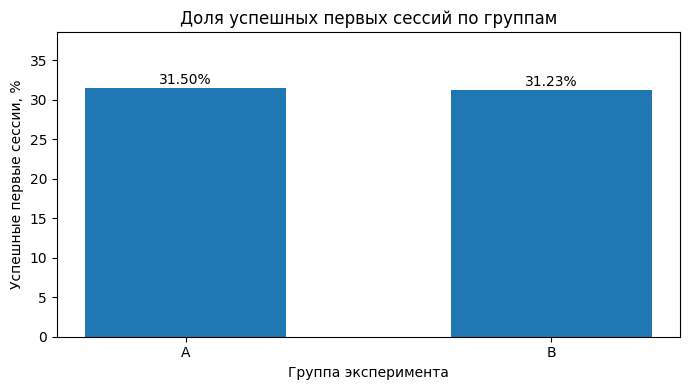

# A/B-тест рекомендательного алгоритма

**Учебный проект по продуктовой аналитике** · Python · Pandas · SciPy · Statsmodels · A/B testing

## Задача

Команда развлекательного приложения с лентой коротких видео разработала новый персонализированный алгоритм рекомендаций. Нужно спроектировать A/B-тест и оценить, увеличивает ли алгоритм **долю успешных первых сессий**. Первая сессия считается успешной, если пользователь просмотрел не менее **4 страниц**.

В эксперименте сравниваются контрольная группа **A** (существующий алгоритм) и группа **B** (новый алгоритм). Анализ выполняется на учебных данных из Яндекс Практикума, а не на данных действующей компании.

## Что сделано

- Проанализированы исторические пользовательские сессии и рассчитана исходная доля успешных первых сессий.
- Рассчитаны **относительный MDE 5%**, размер выборки (11 127 пользователей на группу при α=0,05, мощности 80%) и предполагаемая длительность эксперимента.
- Проверены уникальность пользователей, **Sample Ratio Mismatch (SRM)** и баланс групп по устройствам и регионам.
- Отобраны первые сессии пользователей, пришедшиеся на **14–20 октября 2025 года**.
- Выполнен **односторонний z-тест двух долей** и подготовлена рекомендация для продуктовой команды.

## Результаты

| Показатель | Значение |
|---|---:|
| Пользователи за анализируемый период | **30 450** |
| Контрольная группа A | 15 108 |
| Экспериментальная группа B | 15 342 |
| Успешные первые сессии, A | **31,50%** |
| Успешные первые сессии, B | **31,23%** |
| Изменение B−A | **−0,265 процентного пункта** |
| p-value, односторонний z-тест | **0,6911** |
| SRM p-value | 0,1799 |



**Вывод:** по основной метрике статистически значимого улучшения нет. Внедрение нового алгоритма для всей аудитории **не рекомендовано** без дополнительных исследований. Отсутствие статистически значимого роста не означает доказанную эквивалентность двух алгоритмов.

## Как запустить

Требуется Python 3.11 или 3.12 (локальный запуск на macOS не проверялся).

```bash
python3 -m venv .venv
source .venv/bin/activate
pip install -r requirements.txt
jupyter lab
```

Поместите в папку `data/` три файла из учебных материалов:

```text
data/
├── sessions_project_history.csv
├── sessions_project_test_part.csv
└── sessions_project_test.csv
```

Откройте [`recommendation_ab_test.ipynb`](recommendation_ab_test.ipynb) и выберите **Run All**. Результаты и графики сохранены в ноутбуке для просмотра на GitHub без запуска.

## Структура

```text
recommendation-ab-test/
├── README.md
├── recommendation_ab_test.ipynb
├── requirements.txt
├── assets/ab_result.png
└── data/                 # CSV хранятся локально, в Git не добавляются
```

## Ограничения

- Данные получены в рамках учебной постановки; это **не коммерческий опыт**.
- Проверялась основная метрика первых сессий. Влияние на выручку и долгосрочное удержание отдельно не доказано.
- Для публичного репозитория не включены исходные CSV: они доступны автору в материалах курса и не публикуются без проверки условий использования.
